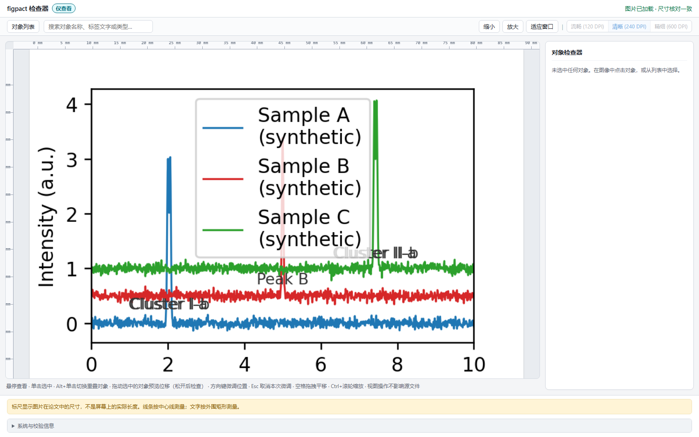
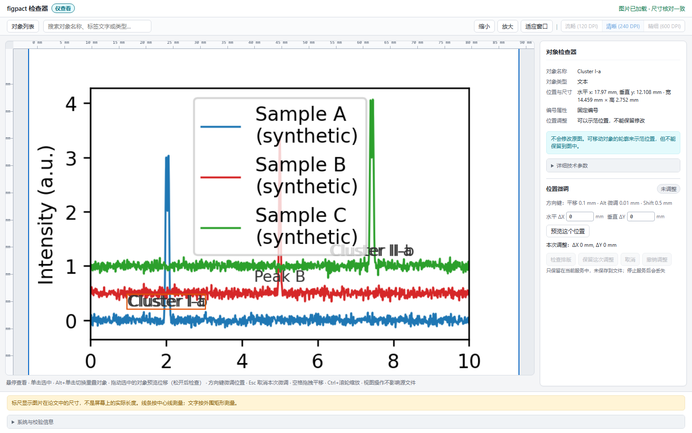
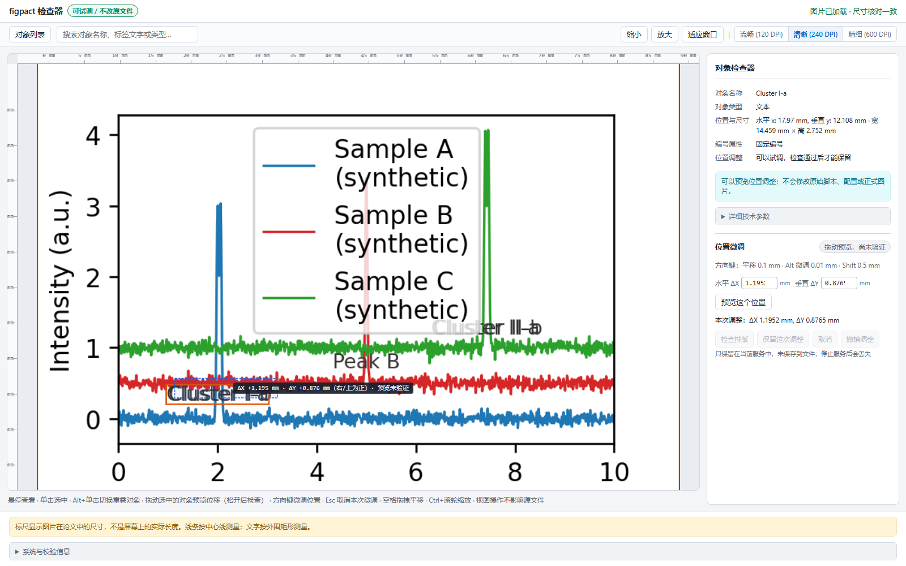
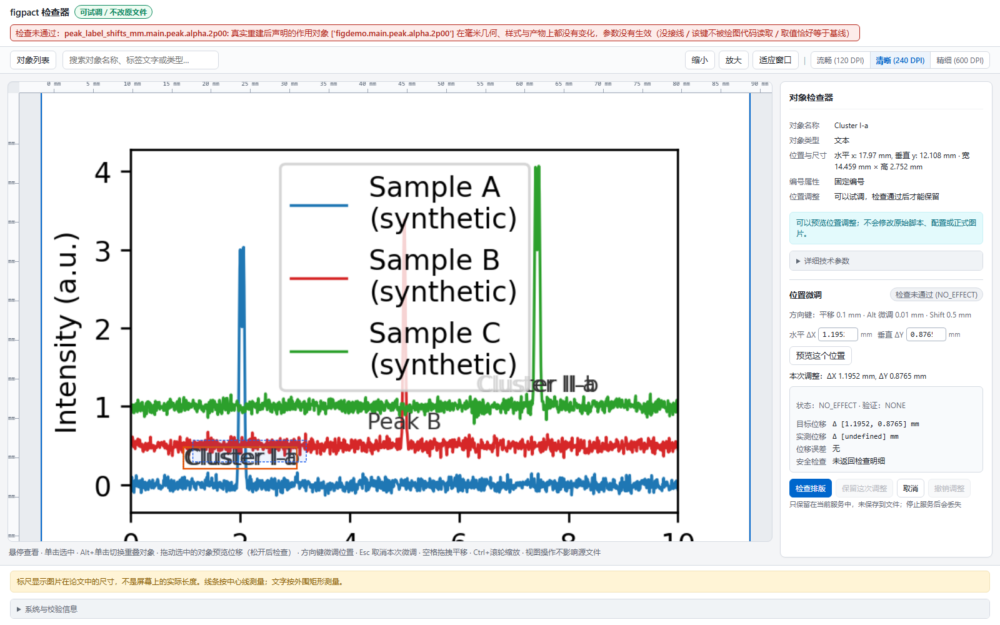
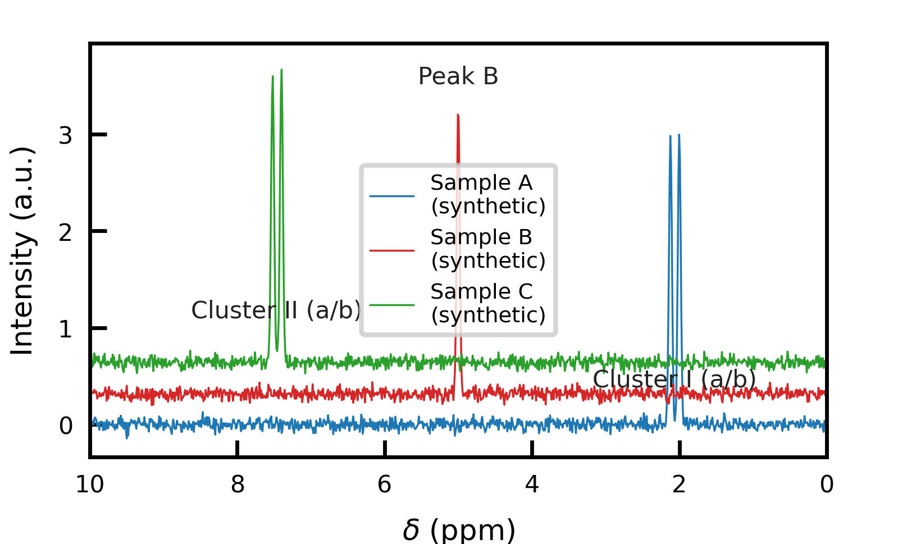
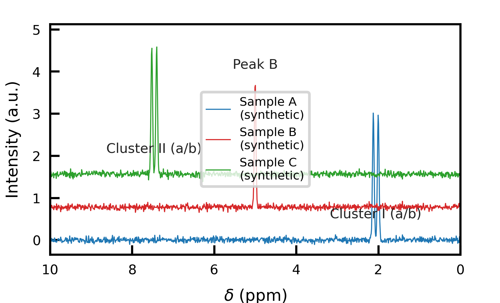
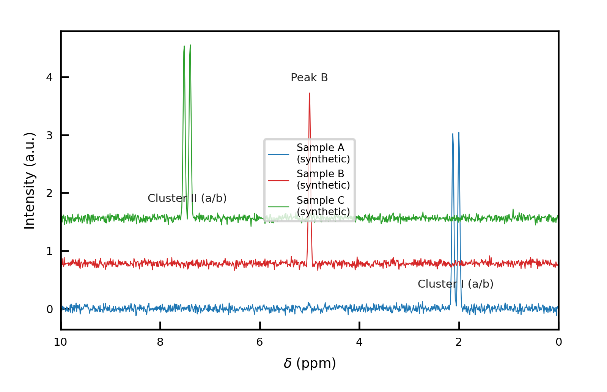
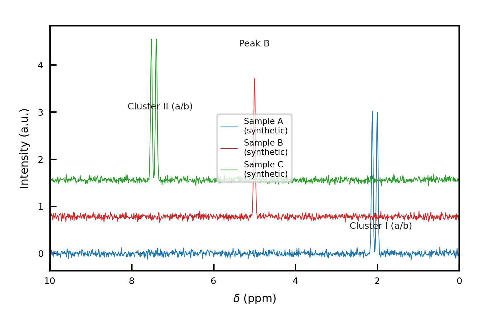
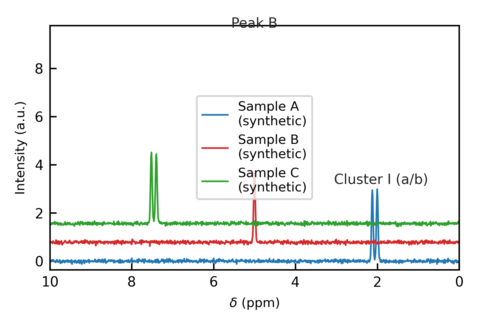
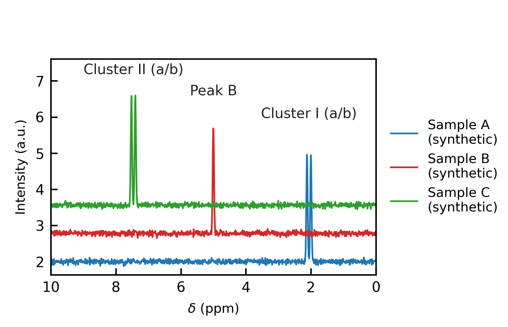

# figpact v0.1

**点选科研图中的对象，用一句话改字号或线宽；真实预览，确认保存，重开复现。**

v0.1 只编辑已有授权对象。Overlay 支持坐标轴标题字号、刻度字号和曲线线宽，保存受控样式 JSON；Native 使用图作者已授权的 YAML 参数与原有事务。科学数据、视图保护、源码漂移检查和严格出版规则不放宽。不支持的对象明确拒绝，不宣称任意 Matplotlib 图兼容或自主定位已经通过盲测。

许可证 **MIT**。安装、边界和三图操作见 [`docs/V0_1.md`](docs/V0_1.md)。G25 暂停、G25-S2 冻结；独立评测仍为 `BLOCKED`，不是这个受限点选产品的发布前置条件。

与 Tavotto 的薄交接（只读尺寸/身份核验，不改布局）见 [`docs/HANDOFF.md`](docs/HANDOFF.md)；反向的 `figpact fit-layout` 可按 Tavotto 占位搜索授权 Native 字号候选，真实 preview，不自动保存。独立渲染会话（无 Tavotto：`figpact render-session`，open/preview/commit/export 的 JSON-RPC）见 [`docs/R14_RENDER.md`](docs/R14_RENDER.md)。

保存版面的全对象快照（G2-A）使用 `figpact layout-snapshot --layout <保存文件> --base <图库根> --canvas <画布ID>`；包含 runtime、照片、文本及组信息，不执行脚本、不修改页面，也不代表当前活动页面。见 [G2-A 使用与证据边界](docs/R14_RENDER.md#g2-a-explicit-saved-tavotto-page)。

活动页面交接与托管图件展示（G2-B/C）使用 `figpact host-session --base <当前项目根> --host-origin <Tavotto 页面来源>`，再由配套 Tavotto 前端显式连接、读取当前页并展示同源 PNG/Scene。它不读取 autosave 冒充活动页面，不自动修改页面尺寸，也不代表最终导出验收。见 [活动页面与 FrameBinding](docs/R14_RENDER.md#g2-bc-active-page-capture-and-managed-frame-display)。

## Quickstart

```bash
python -m pip install "https://github.com/LLLin000/figpact/releases/download/v0.1.0/figpact-0.1.0-py3-none-any.whl"
ollama pull qwen2.5:3b-instruct
figpact ui --browser
```

先启动 Ollama；若未在后台运行，另开终端执行 `ollama serve`。默认使用本机 `http://127.0.0.1:11434/v1`，不需要云端密钥。模型服务不可用时仍可手工填值预览，不会伪造模型回复。

点击图中的 Y 轴标题（或从对象列表选中），输入“改为 9 pt”，检查真实目标和计划，预览后显式保存。默认演示数据由公式生成；样式保存在启动目录的 `figpact-demo.style.json`。退出进程，使用相同命令、相同目录重开，修改仍在。

开发安装：`git clone https://github.com/LLLin000/figpact.git`，进入仓库后执行 `python -m pip install -e .`。自有脚本必须通过本地命令行明确指定，不能从网页上传任意脚本；脚本会执行，只打开可信来源。

## 历史几何编辑演示

以下是既有 `examples/demo/` 的几何编辑教程，不是新的内置曲线自然语言演示；该历史示例的保存限制不代表 v0.1 Overlay 演示的能力。
---

## 逐步演示

下面每一步都是一次真实操作，截图由真实浏览器抓取（`tools/readme/capture_tour.py`，对着 `examples/demo/`）。

### 1. 启动：图加载完成



页面加载的就是脚本渲染出来的图；顶栏显示尺寸核对结果。

### 2. 选中一个标注



悬停即高亮、点击即选中，显示它的 GID 与**这张图允许对它做什么**（能不能改、能不能验证）。

### 3. 拖动：本地即时预览



拖动时只有本地绘制：幽灵轮廓、联动引线幽灵、贴光标的**毫米读数**。**期间不重建 Matplotlib、不请求后端**——所以拖动手感是即时的。

### 4. 松手：真实重建验证



松手后才向引擎要一次真实重建。回执里的实测位移、误差与各项检查都来自这次重建——**预览本身不是证据**，没通过就不会出现"通过"字样。

### 5. 后续步骤：接受 → 保存 → 重启后一致

保存链（待保存区列出目标文件、参数变更与源码差异 → 显式确认 → 原子写入 → 写后重新验证）已在后端与页面上实现，并由真实浏览器用例守着：

```
tests/browser/test_save_flow.py                    2 passed
tests/test_save_loop_g7b.py   （真实 NMR 夹具）    3 passed
```

其中 NMR 全旅程的实测：位移 **0.1500000000000039 mm**（目标 0.15，误差 **3.9e-15**）、保存回执 **COMMITTED + PASS**、配置落盘 `[0.0, 0.15]`、**全新会话从磁盘重建后一致**；拒绝授权与取消时磁盘**逐字节不变**。

> **历史限制（如实说明）**：上面第 5 步的截图覆盖仍只到**第 4 步**。这一段是 `examples/demo/` 的几何编辑教程——它的接受/保存仍被禁用，因为该演示没有声明 science manifest。v0.1 的内置曲线与 FTIR 草稿使用**另一条已验收的 Overlay 保存链**（见 [`docs/V0_1.md`](docs/V0_1.md)）；不要把本段的限制读成 v0.1 全部保存不可用。

---

## 从一张难看的图到出版规格

所有数据由公式生成（固定种子），图是真实渲染；工具**只报数据**，审美决定权在人。

| 阶段 | 准备调什么（意图） | 怎么调（键：旧值→新值） | 预期结果 | 实际结果（实测数字 + 结论） |
|---|---|---|---|---|
| 01 起点 | 无（记录基线问题） | — | — | 越界 4 处、text/curve 重叠 3 处、字号 5.0 pt（图例 4.5 pt 不可行）、clipped 4 |
| 02 | 拉开样品间距，让曲线不再互相压 | `pitch_mm` 0.32→0.78 | 曲线净距拉开、越界减少 | text_curve 4→? 实测 text_bbox 0、clipped 4、图例仍压数据 |
| 03 | 放大画布与边距，给文字留位置 | `canvas_w_mm`/`canvas_h_mm` 66/40→96/62 | 有效字号≥5 pt、边距不挤 | text_bbox 0、clipped 3、infeasible 1 |
| 04 | 解决近峰标签互叠 | `label_min_gap_mm` 0→1.8 + `peak_label_shifts_mm` 分道 | 标签分道、互不重叠、贴各峰 | text_bbox 0、clipped 3、infeasible 1 |
| 05 | 统一字号档位与线宽 | `axis_font_pt`/`tick_font_pt`/`peak_font_pt`/`line_width` | 各角色一档、≥5 pt、线宽一致 | text_bbox 0、clipped 3、infeasible 0 |
| 06 | 图例移出数据区并收尾 | `legend_anchor_x`/`legend_cols` 0.5/1→0.98/1 | 图例不压数据、无裁切、无空白撑开 | text_bbox 0、text_curve 0、clipped 0、rendered_labels 3/3、infeasible [] |








再跑一次：`python tools/readme/render_series.py` 输出确定；本次实测每阶段耗时 ~0.1 s 渲染 + ~0.2 s 审计。

## 最终尺寸统一（痛点二）

同一张论文 Figure 里，**所有面板共享同一缩放比**是期刊的硬要求。figpact 的做法是**按最终尺寸重渲染**，而不是把大图缩下来。

```bash
figpact final-size ...        # 只读审计：先出数，再决定改什么
```

真实数字（`examples/nmr` 与 `examples/ftir`，只读审计）：

| 图 | 目标宽 | 实测导出宽 | k | 轴标题 | 刻度 | 标注 | 线宽 |
|---|---|---|---|---|---|---|---|
| NMR | 42 mm | 41.995 mm | **1.0001** | 8.0 pt | 7.0 pt | 峰标注 6.0 → 4.8 pt ⚠ | 0.8 pt |
| FTIR | 38 mm | 37.973 mm | **1.0007** | 8.0 pt | 7.0 pt | 官能团标注 4.7 → **3.7 pt** ⚠ | 0.8 pt |

受控修改只覆盖**三个角色**（轴标题 / 刻度 / 曲线线宽），写回走既有 YAML 精确补丁 + 漂移检查 + 原子替换，写后重新审计。

**放不下时说放不下**，不自动缩字：

```
infeasible: label_font_pt effective 4.703pt < 5pt; legend_font_pt effective 4.703pt < 5pt
spatial_risk: FTIR label bottom overflow 0.697 mm; Line2D top overflow 2.632 mm (×2)
```

可选取舍：**加宽图 / 移动标注 / 显式指定局部字号**。figpact 不会为了凑宽度去改科学视口、缩字或裁谱线。

---

## 支持边界

- **预览 ≠ 验证**；**写盘 ≠ 科学验证**。只有源码已提交**且**独立重建通过，界面才会说"已保存并通过验证"；写盘成功但验证失败时，页面说的是"源码已写入，但图形验证失败"。
- **不是任意脚本都能编辑**：可编辑需要脚本声明参数契约（`layout_contract()`）与科学基线；没有绑定或绑定歧义时，figpact **拒绝并说明原因**，而不是猜。
- **无 YAML 的图**可以只读测量与示范，但不能保留修改。
- 只信任**本地**脚本；figpact **不是** OS 级沙箱。

第三方脚本接入的 Figure ownership：构图入口返回的 Figure 交由调用方持有／关闭；`science_manifest()`、`layout_contract()` 为提取证据额外创建的 Figure 由脚本创建者负责在 `finally` 中逐个关闭、清除引用，失败与多 scope 路径也一样。
这些提取钩子应返回纯数据，而不是长期缓存 Figure／Canvas／Manager；不能用 `plt.close('all')` 关闭 Inspector 或调用方的 Figure。G22 只验证了 FTIR／NMR 示例，不代表任意第三方钩子已自动满足这一责任。

### 新图型接入检查：统计曲线与误差棒

`examples/statistics/statistical.py` 使用固定合成均值/标准误数组，只声明现有接入协议，
没有为统计图新增适配器。这是协议内新图型检查，不是独立人员盲测，也不是任意零接入脚本支持。
隔离副本实跑：100×75 mm → 80×60 mm，目标轴标题/刻度 8 pt、线宽 0.8 pt。

| 角色 | 发现与扰动验证 | apply 后实测 |
|---|---|---|
| 轴标题 | verified | 8.003 pt |
| 刻度 | verified | 8.003 pt |
| 图例 | verified，compare-only | 7.003 pt，未强制统一 |
| 曲线线宽 | rejected：共享参数还改变未声明的误差棒 LineCollection | 1.2 pt，源码参数未改，不冒充达标 |

视图、6 个 Line2D 的数据坐标和 2 个误差棒集合的线段均前后相等；重复 apply 配置字节不变。
空间校验仍报告 FAIL，不能将该图称为整图通过。草稿允许 `source_commit_state=COMMITTED`
且 `figure_verification_state=FAIL`，但子结果、plate 聚合结果和 CLI 顶层 `status` 均为 `FAILED`
（对象审计阻断时为 `AUDIT_BLOCKED`），`plate unify --apply` 返回退出码 1。
receipt 保留真实的 `COMMITTED / FAIL`，不将验证失败误写为未提交，也不让干净的后续审计抹掉 FAIL。
现有 Apply 是工作草稿保存，不是 Strict 发布；失败图不能作为已验证的正式产物。

可复跑的真实发现→确认→扰动→写盘→CLI 退出码检查（在临时副本中运行，不修改示例）：

```bash
python -m pytest tests/test_statistical_unify.py -q
```

G15 已在冻结引擎上运行第三方 Matplotlib gallery 的多 Axes、统计与混合对象样本，
分开检查原始脚本和仅协议声明两种条件。结果**不支持宣称任意陌生脚本已经可编辑**；
缺入口、缺绑定、源文提示错配与正确拒绝分别记账。
协议、逐项指标、有效性勘误和复跑入口见 [G15 报告](docs/G15_REPORT.md)。

### Verified Style Overlay：不改原 Python 的受控样式（G16 / R2）

没有原生 YAML 参数的可信 Figure，可通过独立 JSON Overlay 持久化三种已验证操作：
xlabel/ylabel 字号、某一轴的可见主刻度字号、唯一连接数据 Line2D 的线宽。
不支持任意方法、误差棒 Collection、柱形、散点、图例或 AST 自动改写。
Overlay 不是原始 Python 源码改写；原始科学程序和配置保持不变。

```bash
python -m figpact overlay inventory --script tools/g15/B/g15b_errorbar_decl.py --scope ax0
# 将 inventory 中选定对象的 id 写入 edits.json：
# [{"target_id": "<inventory 中的精确 id>", "value": 0.8}]
python -m figpact overlay apply --script tools/g15/B/g15b_errorbar_decl.py --scope ax0 --edits edits.json --overlay style.json
python -m figpact overlay render style.json --output edited.png
```

重建时由引擎按结构指纹和源依赖哈希重新定位，不以遍历序号猜对象；缺失、歧义、漂移均拒绝。
更新既有 Overlay 需 `--expected-sha256`（包括同状态重试）；`--edits` 是增量新增/更新，未提及目标保持不变。
重复 `--remove <target_id>` 显式移除已保存目标，移除后恢复原程序样式；移除最后一项得到可重建的空 Overlay。
空请求不会清空已有状态。同请求重复目标、增改与移除冲突、未知移除目标均拒绝，不改变已保存字节。
合并后的**全部目标**重新构建并联合审计，不仅验证最后编辑项；相同完整状态不会累积或重写文件。
局部审计与整图 QA 分开：只有显式 `--allow-draft` 才保存局部通过、整图失败的草稿，
回执为 `COMMITTED_DRAFT / FAIL`，退出码仍为 1，失败草稿不渲染为已验证产物。
首次创建为完整临时文件的原子排他安装；更新复用现有原子替换，沿用单写者约束（非多进程 CAS）。
跨盘声明会保存绝对路径并标记不可移植；普通路径引用与依赖内容均受校验。
声明的 RAW/science inputs 缺失、不可读取或声明 hook 报错均明确拒绝；未声明依赖才是合法空集合。
当前只保护显式 wrapper/RAW/config/science inputs，**不自动追踪所有 Python import 的传递依赖闭包**；辅助科学模块应显式声明。

三个异构陌生图的真实 R2 验收与限制见 [G16 报告](docs/G16_REPORT.md)。
连续编辑、新进程重开、删除与拒绝不落盘证据见 [G17 报告](docs/G17_REPORT.md)。

### 在正式 Inspector 中连续改样式（G18）

```bash
python -m figpact ui --script tools/g15/B/g15b_barchart_decl.py --scope main --overlay work/style.json --port 0
```

打开终端地址，画布点选轴标签/刻度 → 右侧改数值 → **预览样式** → 查看旧值、新值与影响范围 → **确认保存**。
预览不写正式 Overlay；继续选其他对象会保留已保存编辑。“恢复原始”显式移除该目标覆盖，不影响其他目标。
关闭服务后用同一命令重开可恢复状态。位置编辑与样式控制分开，源路径仅启动时指定；HTTP不接受任意路径或方法。
秒级独立验证不会伪装成即时完成，耗时可展开查看。浏览器证据、安全拒绝和极简性审查见 [G18 报告](docs/G18_REPORT.md)。
提交已成功但后续界面重建失败时，页面保留“文件已保存”事实并禁用旧帧编辑，重新打开后恢复；不把显示故障误报为未保存。
真实 FTIR/NMR/统计图的接入成本、QA阻断与5轮性能测量见 [G19 试用报告](docs/G19_REPORT.md)。
“对象有控制权但整图 QA 失败”和“对象存在但无控制权”分别说明；不为示例通过而移动原图图例或降低字形下限。

G20 工作草稿：原图已有 QA 问题时，只有局部／科学／视图审计通过，且按真实对象与实测量比较没有新增或加重问题，才显示 **保存工作草稿**。
保存后仍显示整图未通过及问题数量；同一命令重开可继续编辑，不能据此合规导出。缺少测量、对象歧义、源码漂移或外部 Overlay 冲突均拒绝。
程序接口使用 `style_overlay.load_workspace(path)` 明确读取工作区；严格 `load`／`render` 仍只接受整图 PASS。
已改善的问题不能回退到原图程度；“恢复原始”也遵守当前已保存工作状态的实测门禁。规则见 [G20 协议](docs/G20_PROTOCOL.md)，真实草稿闭环、纯构图等价与五轮结果见 [G20 报告](docs/G20_REPORT.md)。

G21 已用现有 Native/YAML 控制完成真实 NMR 的字号修复、保存、新 worker 重开、继续编辑及严格出版；未新增 Overlay 角色或降低 5 pt 字形下限。
Strict PASS 仍可能保留非阻断 warning；FTIR 在 G21 中未通过严格出版。当时的 Figure 持有问题与能力边界见 [G21 报告](docs/G21_REPORT.md)。

G22 已将声明 manifest／QA 测量异常改为 `AUDIT_INCOMPLETE` 失败关闭，并按明确 ownership 释放 FTIR／NMR 的内部基线 Figure，不关闭调用方 Figure、不削减独立验证。
真实 FTIR 三轮／十轮编辑及失败拒绝后内部 Figure 无持续残留；原出版／草稿语义、完整回归和五轮耗时见 [G22 报告](docs/G22_REPORT.md)。普通刻度裁切 QA 和 FTIR scope 图例限制仍未改变。

G23 已统一主／次刻度与 offset text 的真实画布裁切 QA：合法轴外位置和微小正净空不阻断，实际裁切与不可测量状态接入严格发布和结构化草稿门禁。真实 NMR、FTIR 拒绝与完整回归证据见 [G23 报告](docs/G23_REPORT.md)；未减少独立构图次数。

### 自然语言 → 受控计划（G24，离线）

```bash
python -m figpact.edit_plan --script "examples/nmr/08 NMR.py" --config examples/nmr/nmr.yaml --scope main --overlay work/nmr-style.json --request "把主图峰标注设为 7.2 pt，其他内容不变"
```

默认同时发现 Native／Overlay 的真实契约，输出固定提示、JSON schema 和模型输入包；由外部模型生成 JSON 后，用同样参数加 `--response response.json` 试算。
无 Native 契约的图使用 `--route overlay`。父目录须存在；不自动创建正式 Overlay。
只读发现不生成候选；响应试算仅调用既有 Native `try_layout`／`render_preview` 或 Overlay `inspect_candidate`，返回精确绑定、影响对象及原始回执。
拒绝未知控制、过期修订、非有限数值和跨路径的部分执行；保留科学／视图不变量。`preserve` 必须含字面值 `"science"` 和 `"view"`。
**不自动提交、不写正式配置／Overlay、不授予源码修改权限，也没有新增 GUI 或模型服务依赖。** 当前 scope 由调用方选择，不宣称跨项目／全 scope 自动搜索。
Native 候选受理不等于 `DRAFT_SAVED` 或 `STRICT_VERIFIED`；Overlay 的局部 PASS、整图 PASS 与工作草稿资格分别报告。盲测及接口限制见 [G24 报告](docs/G24_REPORT.md)。


## 测试

```bash
node --test tests/inspector/test_inspector.js     # 前端纯逻辑
python -m pytest tests/browser -q                  # 真 Chromium + 真服务
python -m pytest -q                                # 其余
```
