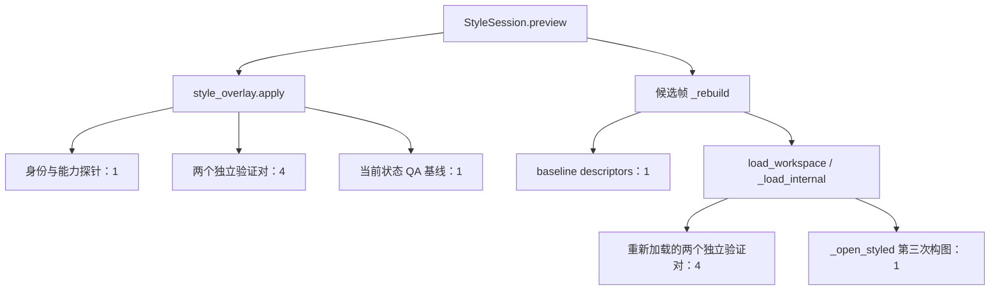

# G21：真实科研图从 QA FAIL 到 Strict PASS

## 结论

**NMR 完成出版闭环，FTIR 未宣称完成。** NMR 从 7 条字形不足记录出发，使用现有 Native Binding/YAML 参数修复，保存、关闭 worker、在新子进程重开、继续编辑并再次出版。最终严格 Overlay `load` 返回 Figure／PASS，严格 `render` 写出 PDF；实际 PDF 最小字形 5.04 pt。没有降低 5 pt 门槛，没有新增 Artist、Overlay 角色、自动布局器或缓存，没有改动产品引擎。

这是现有 Native API 与严格 Overlay API 的真实试验，不冒充本轮新增的 GUI 操作验收。产品代码与 `63273f4` 等价；公开新增的是可复跑试验工具、脱敏结果与报告。G20 历史记录不回填。

## 1. 定位实际对象和控制权

NMR 基线为真实 G19/G20 归档输入的隔离副本。以下 7 个对象母体字号都是 6.0 pt，数学上下标有效字号为 `6.0 × 0.7 = 4.2 pt`，阈值为 5.0 pt；记录规则为 `GLYPH_FLOOR`，severity 为 warning，但严格整图字形检查不通过。

| 真实对象（前缀 `fig2_nmr.main.`） | 角色 | 现有控制 |
|---|---|---|
| `peak.hama.6p18` | 峰归属文字 | `peak_font_pt` |
| `peak.vanoh.4p62` | 峰归属文字 | `peak_font_pt` |
| `peak.vancho.3p91` | 峰归属文字 | `peak_font_pt` |
| `peak.vannh2.3p03` | 峰归属文字 | `peak_font_pt` |
| `peak.hama.2p02` | 峰归属文字 | `peak_font_pt` |
| `peak.vancho.3p68` | 峰归属文字 | `peak_font_pt` |
| `legend.text.vannh2` | 样品图例文字 | `legend_font_pt` |

这两个字号参数已在 Native contract 中声明为 EDITABLE／rebuild，范围 3–12 pt。画布宽度也已有 resize 控制。不是根据参数名字猜控制权。

Overlay 仍只支持 `axis.title`、`axis.tick`、`curve.linewidth`；峰标签／图例字号不在其 inventory 中。修复走已有 Native `set_parameter` 事务，没有伪造 Overlay target 或扩大权限。最后才使用已授权的轴标题 Overlay 验证严格导出链。

FTIR 的 annotated 基线另外实测到 10 条字形不足：5 个 `band.*` 和 5 个 `legend.text.*`，纯文字为 4.7 pt，数学上下标为 3.29 pt。annotated contract 已绑定 `label_font_pt` 和 `legend_font_pt`；main 没有 band 标签，不能将 annotated 的绑定当作 main 的授权。Overlay 也不支持这些对象的字号。

## 2. 受控修复：只用必要的现有参数

最终 NMR 修复事务如下；所有改动只作用于隔离副本的候选配置。

| 参数 | 基线 | 最终修复 | 理由 |
|---|---:|---:|---|
| `peak_font_pt` | 6.0 pt | 7.2 pt | 数学字形达到 5.04 pt |
| `legend_font_pt` | 6.0 pt | 7.2 pt | 数学字形达到 5.04 pt |
| `canvas_w_mm` | 48 mm | 68 mm | 保留全部峰标签并容纳最右刻度 |
| `canvas_h_mm` | 48 mm | 48 mm | 不改变 y 视口 |

不能只把字号调大后看是否退出成功。48 mm 原尺寸的较大字号候选会使既有避让过程丢失受保护标签，科学指纹检查拒绝。早期 60×60 mm 候选虽然通过 Native 声明的布局视口规则，但实际 ylim 改变，因此**不计入本轮“视图不变”验收**。

改为只扩宽后，60×48 mm 候选的最右 `0.0` 刻度还超出画布约 0.75 px；实际 PNG 视觉检查发现了它，不能用当前 QA 记录为空遮盖。最终 68×48 mm 候选在 120 DPI 的所有可见 Text bbox 内，最紧的刻度尚余约 0.39 px。这个余量很小，不是充足出版留白的保证。

最终独立新建 baseline／candidate 后验证：

- raw xlim 均为 `[10.5, 0.0]`，raw ylim 均为 `[-6.0, 304.99999999999994]`，两轴均 linear，逐值相同。
- 4 条科研曲线的数组相同，7 个峰标签全部保留，11 个峰／图例文本相同。
- 科学 digest 相同：`e5d4f227912792b6ee506a1d992d90a0f7ad097135d75a30d7d9f70650c7a170`，科学对象差异为空。
- `qa.measure` 从 7 条字形不足变成空记录；既有 Native 对象级声明效果检查通过，`science_unchanged=true`。
- 原数据的 12 个声明输入文件与 G19 归档逐字节相同；脚本、原配置和样式依赖也与归档哈希一致。

**“原视图不变”指数据窗口与轴尺度类型相同，不表示物理横向比例不变。** 画布加宽改变了同一 x 窗口的物理占位；它是明确授权的布局改动，不是截取或隐藏谱峰。

### 保留的告警与 QA 边界

Strict PASS 不等于零 warning。基线有 3 条标签贴边 warning，最终有 2 条；剩余 `–CHO`、`–COOCH₃` 按现有检测口径仍是 0.80 mm，未通过降低 1 mm 规则消除。较宽画布消除另一条，没有新增贴边告警。最终严格回执仍显示这些 warning。

当前 `qa.measure` 不检查普通刻度文字的画布裁切。68 mm 方案因此额外保留了真实 renderer Text bbox 校验；父进程还检查了最终严格 Overlay Figure 的可见文字 bbox，以及实际导出 PDF 的文本 span，没有越出画布／页面。**这项补充证据不是已修复产品 QA 覆盖缺口的声明。**

## 3. 保存、重启、继续编辑和严格导出

实际执行链：

1. Native `try_layout` 三参数事务：`OK / RENDER_CHECKED`，科学不变、新阻断为空。
2. 新沙箱 `--strict --probe`：退出码 0，实际生成 PDF／PNG／SVG／TIFF；从 PDF 读取字形，最小 5.04 pt。
3. `AgentSession.commit("publication")`：`committed / STRICT_VERIFIED`。
4. 关闭 session／worker，在新子进程读已保存配置：重开值为 7.2／7.2／68／48，未依赖旧 Figure。
5. 继续将已有 `note_font_pt` 从 5.5 改为 6.0，实际再次 commit，而非仅预览；再次 `STRICT_VERIFIED`，落盘 YAML 读回为 6.0，四种图片重新安装，PDF 最小字形仍为 5.04 pt。
6. 在最终落盘 Native 配置上，通过已有轴标题目标把 xlabel 8.5→9.5：Overlay 预览／确认返回 `COMMITTED`，严格 `load`（不是 `load_workspace`）返回 Figure，局部 PASS、整图 PASS；严格 `render` 生成实际 PDF，字形最小 5.04 pt。

父进程实际查看了安装后的 PNG 和严格 Overlay PDF 的光栅预览；同时检查 PDF 文本 span 在页面内。没有用单元测试替代实际产物。

私有最终证据位于仓库外 `g21/nmr_proof7/`：`nmr_evidence.json`、`restart_continued.json`、`pdf_audit.json`、`strict_overlay_proof.json`；图片在 `installed/`，额外严格 Overlay PDF 在 `strict_overlay/`。公开文件哈希和脱敏检查结果见 [results.json](../tools/g21/results.json)。PDF 哈希标识本次实际文件，不承诺再次导出的元数据逐字节相同。

## 4. FTIR：保留失败证据，不扩大本轮能力

实测候选将 annotated 的图例／标签字号设为 7.2，并将画布高度设为 57.5 mm：Native 预览对象审计与科学指纹通过，但 ylim 从约 `[38.7045,1005.4904]` 变成 `[38.7045,1196.8335]`，不满足本轮严格的视图不变要求。

此外，原脚本的 publication 会严格验证 main、annotated 和 raw／processed compare 整组输出。该候选在 compare 图中出现 4 条 `TEXT_ON_DATA`，严格进程退出码 1，拒绝发布，没有最终 PDF／图片可供验收。不能把 annotated 局部预览成功当成整组 Strict PASS，也没有伪造 PDF 审计。

现有图例锚点是全局参数：测试中，能缓解 compare 压线的位置又会使 main／annotated 图例出画布或与轴标题重叠。已测试候选呈现出 scope 耦合控制的限制；**不是对整个参数空间作“不可能”证明**。可能的最小后续能力是受作用域约束的图例位置控制，但本轮不实现，因为 NMR 已用现有能力完成要求，不为第二张图扩大范围。

公开 FTIR probe 退出码 0 仅表示证据采集完成；其中 `strict_probe.returncode=1` 才是本次出版结果。FTIR runner 最终版本已实际重跑，仍如实记录拒绝。

## 5. 实际调用链与 Figure 生命周期（仅诊断，不做 G22 重构）

对真实 FTIR 的一次预览，trace 得到下面的构图目的。箭头表示实际调用路径；数字是该路径中 `_build_figure` 的调用数，不是可随意删除的冗余次数。



这同时验证了用户指出的 apply 后再 load 现象。候选已被写入私有 Overlay，之后重新加载还涉及新磁盘状态及最终渲染 Figure；本轮**未证明这些计算验证的是完全同一事实**，所以没有合并任何验证。G16 独立对、重新打开、科学指纹、QA、提交前漂移检查全部保留。

更明确的问题来自 manifest：每次 preview／commit 的 12 次受控 build 之外，还创建了 20 个用于科学 manifest 的基线 Figure。FTIR `science_manifest` 经 `_baseline_scene` 为 4 个 scope 取场景；缓存以导入模块为界，新导入会重新创建。实验中 pyplot 管理器持续持有这些 Figure。

下面是同一进程实际连续 3 次“预览＋确认”的观察。每次动作后主动 GC 仅用于诊断，没有在动作之间 `close('all')`；RSS 不能独自证明泄漏，所以同时观察弱引用与 pyplot ownership。

| 观察点 | pyplot 管理 Figure | GC 后存活 Figure | GC 后 RSS（MiB） |
|---|---:|---:|---:|
| 开始前 | 0 | 0 | 66.7 |
| 启动后 | 0 | 0 | 88.2 |
| 第 1 次预览后 | 20 | 20 | 285.5 |
| 第 1 次确认后 | 40 | 40 | 473.1 |
| 第 2 次预览后 | 60 | 60 | 685.3 |
| 第 2 次确认后 | 80 | 80 | 872.2 |
| 第 3 次预览后 | 100 | 100 | 1053.1 |
| 第 3 次确认后 | 120 | 120 | 1238.9 |
| 释放 session 并 GC 后 | 120 | 120 | 1238.9 |

累计创建 194 个 Figure。这里已经有明确的持有问题，不只是“可能是 allocator 没归还内存”；但 RSS 仍含分配器保留，不能把每一字节都归因为 Figure。当前问题尚未修复，不将它计作 G21 的性能收益。G22 应先界定 manifest baseline Figure 的 ownership／释放，再谈验证合并和延迟优化。

## 6. 复跑与回归

对已有只读归档的**私有隔离副本**运行；所有输出目录必须新建，不能指向研究原目录。路径由命令行显式传入，不嵌入公开工具。NMR 试验仅适用于本次参数／图契约，不能当作任意 NMR 自动修复器。

```text
python tools/g21/nmr_publication.py --script "<隔离副本/08 NMR.py>" --config "<隔离副本/nmr.yaml>" --output-dir "<新证据目录>" --save
python tools/g21/ftir_publication.py --stage "<隔离FTIR目录>" --out "<新证据目录>"
python tools/g21/workflow_trace.py --script "<FTIR脚本>" --config "<FTIR配置>" --output-dir "<新trace目录>" --edits 3
```

实际运行环境已安装 psutil，生命周期 probe 用它测进程 RSS，不新增产品依赖。probe 的 GC／profiling 会改变时序，所以不产生 G20/G22 可比性能结论。

相关回归真实执行：

```text
python -B -X utf8 -m pytest tests/test_python_native.py tests/test_python_native_edit_flow.py tests/test_python_native_example.py tests/test_science_invariants.py tests/test_agent_api.py tests/test_qa_draft_metrics.py tests/test_overlay_safe_draft.py -q -p no:cacheprovider --tb=short
```

结果：**101 passed、2 skipped、4 subtests passed，127.12 秒**。另实际运行 NMR 完整试验、FTIR 严格拒绝 probe 和 FTIR 连续编辑生命周期 probe。没有产品／GUI 代码变化，因此本轮未重跑完整浏览器或全量回归，不引用 G20 的计数冒充 G21 新执行结果。

未改动研究原始文件，未提交科研原始数据、私有脚本或图像；公开仓库仅保留复跑工具、脱敏结果及本报告。
