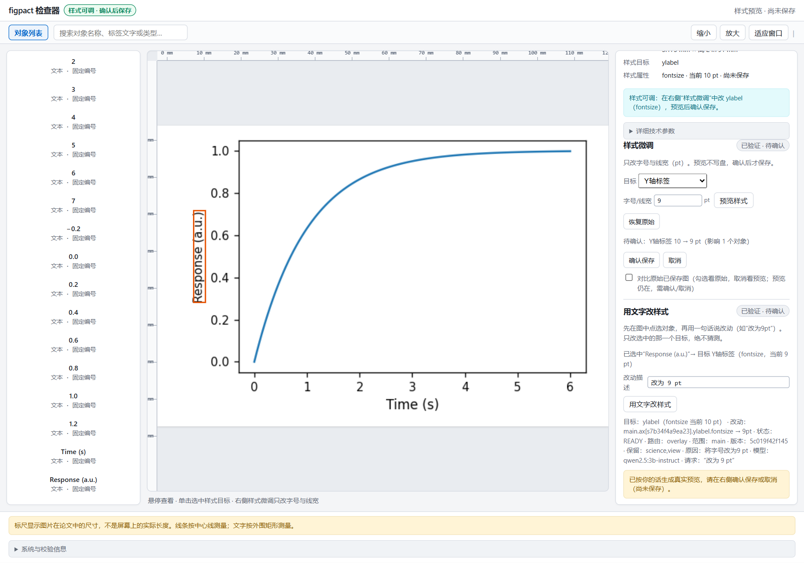
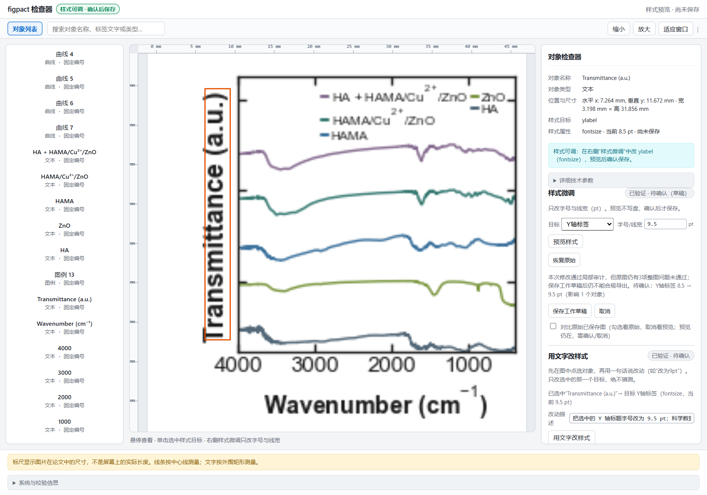

# figpact v0.1：点选、修改、保存、重开

## 安装与第一张图

Python 3.10+；本地浏览器。安装发布页的 `figpact-0.1.0-py3-none-any.whl`：

```bash
python -m pip install ./figpact-0.1.0-py3-none-any.whl
ollama pull qwen2.5:3b-instruct
figpact ui --browser
```

Ollama 未后台运行时，另开终端执行 `ollama serve`。不需要云端 API 密钥。内置曲线使用公式数据，不依赖仓库中的 NMR/FTIR 原始文件。

1. 点击 Y 轴标题，或打开对象列表选中 `Response (a.u.)`。
2. 在自然语言输入框输入“改为 9 pt”，生成真实候选。目标来自当前点选对象，不让模型搜索或猜测整张图。
3. 检查真实目标、控制、数值和计划；对照修改前后预览。拒绝、取消、重新输入或手工修改数值均不会自动保存。
4. 点击明确的保存按钮。只有保存回执确认提交才表示落盘；预览不是保存。
5. 终端 Ctrl+C 退出，使用相同命令、相同启动目录重开。`figpact-demo.style.json` 持有样式；原脚本和科学数据不变。

已有候选必须先确认或取消，不能让新的模型请求悄悄覆盖尚未确认的结果。选中的对象没有相应授权时，不调用模型来绕过边界；一个对象映射多个控制时先明确选择控制。

## 自有可信脚本

```bash
figpact ui --script /path/to/figure.py --scope main --overlay /path/to/figure.style.json --browser
```

需要图脚本的现有接入契约：`build_figure_and_registry(scope)`，以及可审计的稳定对象身份。可对照安装包中的 `figpact/sample.py`。配置文件可用 `--config` 明确指定；脚本会执行，**仅打开可信代码**。没有网页上传／任意 HTTP 路径加载接口，也不把本地执行说成安全沙箱。

| 路径 | v0.1 范围 | 保存位置 |
| --- | --- | --- |
| Overlay 自然语言／手工 | `axis.title.fontsize`、`axis.tick.fontsize`、`curve.linewidth` | 启动时明确指定的受控样式 JSON |
| Native 手工参数 | 当前图真实契约中明确标为可编辑的标量参数 | 启动时明确指定的 YAML，使用现有 Native 事务 |
| 旧几何编辑 | 原有适配图、授权与保存规则 | 原有路径；不是自然语言的新授权 |

Native 单独启动，不与 `--overlay` 混用。Native v0.1 不提供自然语言多参数规划；两条保存路径分别使用既有事务，不承诺跨路径原子提交。

## 模型配置与隐私

只提供一种 OpenAI-compatible Chat Completions 调用方式，必须支持严格 JSON-schema 输出。默认 Ollama + `qwen2.5:3b-instruct`。可在**启动服务的进程环境**设置：

- `FIGPACT_MODEL_BASE_URL`：API 根地址，默认 `http://127.0.0.1:11434/v1`。云端服务使用 HTTPS；地址不能嵌入用户名、密码或查询凭据。
- `FIGPACT_MODEL`：模型 ID。
- `FIGPACT_MODEL_API_KEY`：可选 Bearer 密钥，仅服务端读取；不写入网页、控制清单、编辑计划或样式文件。拒绝重定向，不向重定向主机转发密钥。

传给模型的是用户请求、当前 scope/revision 和**一个选中控制**的授权元数据，不发送原始科学数据、图像、源文件内容或本地绝对路径。拒绝／澄清、错误 JSON、其他控制 ID、布尔值、过期修订、来源漂移和越权均不能取得提交权限。模型服务不可用／不兼容时明确报错；手工填值仍可用，没有假模型或静默降级。

## 三张图的验收操作

NMR/FTIR 例子需要完整源码仓库和原有数据，未塞入通用 wheel。以下命令会将用户确认的修改写入指定文件；对正式科研文件先备份，不对原始测量文件做写入。





### 普通曲线：Overlay 自然语言与持久化

使用开头的内置曲线。Y 轴标题 10→9 pt，真实预览、取消一次，再预览并确认。停止服务后重开，确认当前值／已保存值均为 9 pt。整图 QA 的 PASS 不是出版 Strict PASS 的替代品。

### NMR：授权 YAML 与严格出版

```bash
figpact ui --script "examples/nmr/08 NMR.py" --config examples/nmr/nmr.yaml --scope main --native --browser
```

在 Native 参数面板使用真实授权控件。出版候选采用既有验证组合：`peak_font_pt=7.2`、`legend_font_pt=7.2`、`canvas_w_mm=70`、`canvas_h_mm=48`；先预览，再明确选择严格出版提交。未达到严格条件时不能按 Strict PASS 保存；可以拒绝或取消。重开后从 YAML 读取，不能依赖浏览器内存。

### FTIR：符合条件的工作草稿，不冒充 Strict PASS

```bash
figpact ui --script examples/ftir/plot_ftir.py --config examples/ftir/ftir.yaml --scope main --overlay ftir.style.json --browser
```

选 Y 轴标题，将 8.5 改为 9.5 pt。既有原图问题可能仍使整图 FAIL；只有局部安全、没有新增／恶化问题且所有必要测量完整时才允许“保存工作草稿”。确认后重开仍显示草稿、原图问题和已保存值。工作草稿不能合规导出，也不会被重新标成 Strict PASS。

## 实测证据

以下数字来自本机真实运行，不是估算：

- 后端：`719 passed / 7 skipped / 120 subtests`；Chromium `28 passed`；Node `56 passed`。
- 内置曲线：真实 Ollama `qwen2.5:3b-instruct` 计划绑定选中 ylabel，预览 10→9 pt；取消后仍为 10 pt、正式文件不存在；再预览并显式保存，进程重启后 `current_pt=9`、`saved_pt=9`。
- NMR：真实 Native 会话 22 个授权标量；`peak_font_pt=7.2`、`legend_font_pt=7.2`、`canvas_w_mm=70` 预览不写盘；取消恢复 6/48；再次预览并正式提交得到 `STRICT_VERIFIED`；新进程重开读到 `7.2/7.2/70/48`。
- FTIR：9.5 pt 候选局部审计通过、整图仍有 3 项问题；明确标注“保存工作草稿”；新进程重开后仍是 `workspace_draft=true`、`current_pt=saved_pt=9.5`、3 项问题，未冒充 Strict PASS。
- 证据文件：`tools/v01/evidence/`；界面截图：`docs/v01/`。

与 Tavotto 的版面交接见 [`HANDOFF.md`](HANDOFF.md)：真实 fig2 的 A 版三个 PDF panel 均为 `scale=1.0`；B 版 NMR/FTIR/XRD 均非等比放大，FTIR 纵向仅 `0.895265`。

## 明确不做

不支持任意 Artist、任意 Python 脚本自动接入、无人确认自动提交、自然语言自主找任意目标、多模型编排、自动完美布局或 Native/Overlay 混合事务。动态布局改变数据几何、不可测几何、科学／视图变化以及越权继续失败关闭。未知不是通过；不保证所有原图可编辑或可出版。

G25 暂停，G25-S2 冻结。所有产品演示与提示调试属于开发暴露，不是独立金标准或盲测成绩；0 个已认证未见图族、0 道冻结题目的研究边界不变。
